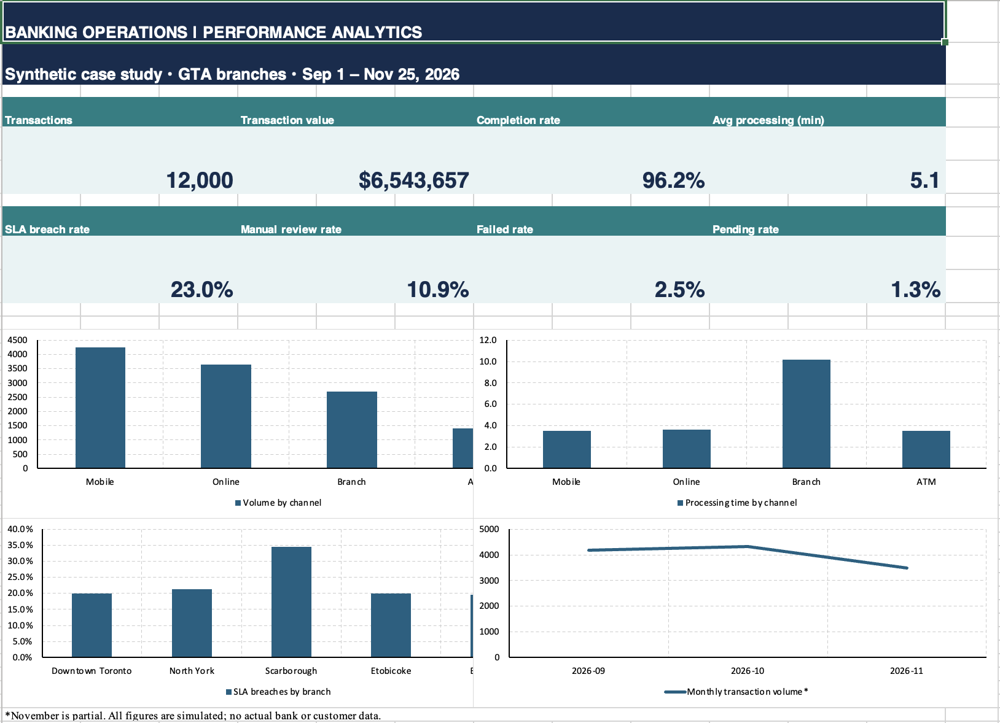

# Banking Operations & Performance Analytics

An independent business analytics project exploring operational efficiency, transaction processing, and service-level performance within a simulated Canadian retail banking environment.

## Project at a Glance

| Transactions Analyzed | Operational KPIs | Banking Branches | Business Recommendations |
| :---: | :---: | :---: | :---: |
| 12,000 | 8 | 5 | 3 |

## Dashboard Preview

## Business Objectives

- Identify operational inefficiencies and processing bottlenecks.
- Evaluate branch-level and channel-level performance.
- Analyze service-level agreement (SLA) compliance.
- Develop data-driven business recommendations.

## Key Findings

- **96.17%** transaction completion rate.
- **23.03%** SLA breach rate.
- **5.06 minutes** average transaction processing time.
- Manual reviews take nearly three times longer than automated processing.

## Business Recommendations

1. Promote digital self-service for routine transactions.
2. Optimize branch staffing and resource allocation.
3. Automate eligible low-risk manual validation processes.

## Tools & Technologies

- Microsoft Excel
- SQL (planned)
- Power BI (planned)

## Project Files

- [Excel Dashboard](dashboard/banking_operations_dashboard.xlsx)
- [Transaction Dataset](data/banking_transactions.csv)

## Project Roadmap

- [x] Synthetic dataset development
- [x] KPI development
- [x] Excel dashboard
- [x] Business recommendations
- [ ] SQL analysis
- [ ] Power BI dashboard

## Disclaimer

All data is synthetic and created exclusively for educational and portfolio purposes.
